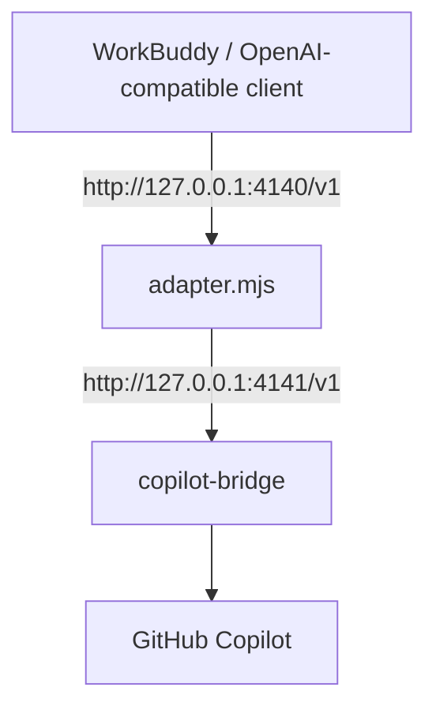

# GitHub Copilot Proxy

为 WorkBuddy 等支持 OpenAI Chat Completions 协议的桌面客户端提供本地 GitHub Copilot 接口。

本项目在 [copilot-bridge](https://github.com/albanx/copilot-proxy) 前增加一层适配：自动获取账号可用的模型目录，并将需要 Responses API 的模型输出转换为 Chat Completions 格式。本地接口无需 API Key。

> **非 GitHub 官方项目。** 需要你自己的有效 Copilot 订阅和使用权限，不提供共享账号、GitHub Token 或免费额度。请遵守 [GitHub 使用政策](https://docs.github.com/site-policy/acceptable-use-policies/github-acceptable-use-policies)及 [Copilot 条款](https://docs.github.com/site-policy/github-terms/github-terms-for-additional-products-and-features#github-copilot)，并确认组织允许此类客户端。上游接口可能随时变化。

## 功能与边界

- `GET /v1/models`：返回桥接服务实时提供的账号模型目录，无需手动配置。目录缓存在内存中，每 5 分钟刷新；请求未知模型时会立即刷新一次。
- `POST /v1/chat/completions`：支持普通响应与 SSE 流式响应。
- 保留文本、图片、函数工具调用与工具结果历史；Responses 路径支持推理内容、结构化输出与 token 用量转换。
- 自动选择上游接口：模型声明了 `supported_endpoints` 时按声明路由；未声明时先走 Chat Completions，上游提示该模型不支持 Chat Completions 时自动改走 Responses，并在本次运行期间记住。
- 监听地址由 `host` 配置，默认 `127.0.0.1`，支持指定本机 IPv4 地址或 `0.0.0.0`；无需 API Key，不校验 `Origin` 请求头；请求体上限为 16 MiB。
- 不在适配器端暴露 `/v1/responses`、`/v1/messages`、`/v1/embeddings`，也不承诺完整兼容所有 OpenAI 参数。Responses 路径仅支持 `n=1`，不支持 `stop`。



图中为默认监听地址和端口；可通过本机 `adapter-config.json` 中的 `host`、`port` 和 `bridgePort` 修改。

## 环境要求

- Windows 10/11、Windows PowerShell 5.1。
- Node.js 22 或更高版本、npm、Git。
- 有效的 GitHub Copilot 订阅，以及可以访问 GitHub / Copilot 服务的网络。
- 本机配置的两个端口未被其他程序占用（默认 `4140`、`4141`）。

以下命令在 PowerShell 中执行。启动脚本目前面向 Windows；其他平台需要自行管理两个 Node.js 进程。

## 快速开始

### 1. 下载并安装

```powershell
git clone https://github.com/jiangweifang/Github-Copilot-Proxy.git
Set-Location .\Github-Copilot-Proxy
npm ci
```

依赖版本由 `package-lock.json` 锁定。如果公司网络限制公共 npm，请按所在组织的规范配置自己的 npm 镜像；不要把带凭据的 `.npmrc` 提交到仓库。

### 2. 登录 GitHub Copilot

```powershell
npm run auth
```

按终端提示完成浏览器设备授权。GitHub 登录凭据由 `copilot-bridge` 管理，不要填入本项目的配置或 README。依赖的默认凭据缓存位于用户目录下的 `.local\share\copilot-api\github_token`，不要复制或上传此文件。

### 3. 检查本机配置（可选）

仓库自带的 `adapter-config.json` 只包含监听地址和端口，不含账号数据，默认值可直接使用。模型目录无需配置：适配器启动后会从本机桥接服务的 `/v1/models` 自动获取你账号可用的模型。

本地接口不需要 `apiKey` 配置或 `Authorization` 请求头；旧配置中的 `apiKey` 可以删除，残留字段会被忽略。GitHub Copilot 登录仍然必需，由桥接服务管理。

#### 本地配置说明

```json
{
  "host": "127.0.0.1",
  "port": 4140,
  "bridgePort": 4141
}
```

| 字段 | 说明 |
| --- | --- |
| `host` | 适配器和桥接服务的监听地址，接受标准点分十进制 IPv4 地址：`127.0.0.1`（默认，仅本机）、`0.0.0.0`（所有 IPv4 网卡），或本机已有的网卡地址。不接受主机名或 IPv6。 |
| `port` | 客户端访问适配器的端口，默认 `4140`。 |
| `bridgePort` | 适配器访问本机桥接服务的端口，默认 `4141`。 |
| `models` | 可选。按模型 `id` 覆盖自动获取的模型属性，通常不需要填写，见下文。 |

两个端口必须是 `1` 至 `65535` 的整数，且不能相同。旧配置未填写 `host` 时默认监听 `127.0.0.1`，未填写端口时仍使用默认端口。例如将 `port` 改为 `4240`、`bridgePort` 改为 `4241` 后，`npm start` 会同步启动对应端口，适配器也会自动连接新的桥接端口。客户端 Base URL 则需改为 `http://127.0.0.1:4240/v1`。

将 `host` 改为 `0.0.0.0` 并重启后，两个服务都会监听所有 IPv4 网卡。其他设备使用 `http://<服务所在机器的IP>:<port>/v1` 访问，本机仍可使用 `127.0.0.1`；不要把 `0.0.0.0` 当作客户端访问地址。也可以填写本机已有的具体 IPv4 地址，只监听对应地址；如果地址不属于本机，服务会启动失败，不会自动改为其他地址。

适配器连接同机桥接服务时，`host` 为 `0.0.0.0` 就使用 `127.0.0.1`，否则使用配置的具体地址。客户端也应使用对应的可访问地址。本项目不会自动修改网卡地址或 Windows 防火墙规则。

**Responses 模型的路由。** `copilot-bridge` 2.1.0 的模型列表不返回原始 `supported_endpoints`，因此适配器对未声明接口的模型先尝试 Chat Completions；上游返回“该模型不支持 Chat Completions”的 `400` 错误时，自动改用 Responses 重试，并在本次运行期间直接走 Responses。首次调用这类模型会多一次被拒绝的上游请求。

如需固定某个模型的路由，可在 `models` 中按 `id` 添加覆盖项，其字段会合并到自动获取的模型信息上；不在账号目录中的覆盖项会被忽略，不能借此添加模型：

```json
{
  "host": "127.0.0.1",
  "port": 4140,
  "bridgePort": 4141,
  "models": [
    {
      "id": "YOUR_RESPONSES_MODEL_ID",
      "supported_endpoints": ["/responses"]
    }
  ]
}
```

`supported_endpoints` 包含 `/responses` 时走 Responses；只包含其他接口时固定走 Chat Completions，不再自动回退。修改配置后需重启适配器。

### 4. 启动

```powershell
npm start
```

启动脚本同时管理桥接服务和适配器；保持此终端打开，使用 `Ctrl+C` 停止。它不会关闭其他已占用端口的程序。如果任一子进程退出，脚本会报错并清理自己启动的子进程。

日志保存在项目目录中的 `proxy.log`、`proxy-error.log`、`adapter.log`、`adapter-error.log`，均被 Git 忽略。桥接服务完成初始化前，适配器会对请求返回 `503`（模型目录暂不可用），稍后重试即可。

### 5. 配置 WorkBuddy

在 WorkBuddy 的自定义模型 / OpenAI 兼容提供商设置中填写（具体界面名称以客户端版本为准）：

| 配置项 | 值 |
| --- | --- |
| 接口类型 | OpenAI / Chat Completions |
| Base URL | `http://<服务所在机器的IP>:<port>/v1`，本机默认 `http://127.0.0.1:4140/v1` |
| API Key | 留空；客户端强制要求填写时可填任意占位值，例如 `unused`，服务端会忽略 |
| 模型 ID | `/v1/models` 返回的一个确切 ID |

不要把 Base URL 指向桥接端口（`bridgePort`，默认 `4141`），否则会绕过本项目的适配层。不要把 GitHub Token 填入客户端的 API Key 字段。

## 验证接口

保持 `npm start` 运行，在另一个 PowerShell 终端执行：

```powershell
$config = Get-Content -LiteralPath .\adapter-config.json -Raw | ConvertFrom-Json
$adapterPort = if ($config.PSObject.Properties.Name -contains 'port') { $config.port } else { 4140 }
$listenHost = if ($config.PSObject.Properties.Name -contains 'host') { $config.host } else { '127.0.0.1' }
$serverAddress = if ($listenHost -eq '0.0.0.0') { '127.0.0.1' } else { $listenHost }
$baseUrl = "http://${serverAddress}:$adapterPort/v1"
$models = Invoke-RestMethod -Uri "$baseUrl/models"
$models.data | Select-Object id

# Enter an available chat model from the list; this request consumes account quota.
$modelId = Read-Host 'Chat model ID'
$body = @{
    model = $modelId
    messages = @(@{ role = 'user'; content = 'Hello' })
    stream = $false
} | ConvertTo-Json -Depth 10
Invoke-RestMethod -Uri "$baseUrl/chat/completions" `
    -Method Post -ContentType 'application/json' -Body $body -TimeoutSec 300
```

流式客户端使用同一接口并传入 `"stream": true`，响应为 SSE，结束标记为 `data: [DONE]`。

## 模型目录更新

无需手动操作。适配器每 5 分钟从桥接服务刷新一次模型目录；请求目录中没有的模型时会立即刷新（最多每 10 秒一次）。刷新失败时继续使用上次成功获取的目录。目录来源是 `copilot-bridge`，它也会定期从 GitHub 刷新；账号权限变化后若长时间看不到新模型，可重启 `npm start`。

## 安全与隐私

- 仓库不包含登录凭据、登录缓存、私有模型清单、本机配置或运行日志。`.gitignore` 防止这些常见文件被误提交，但不能替代提交前检查；不要使用 `git add -f` 添加敏感文件。
- `adapter-config.json` 只包含监听地址、端口和可选的模型路由覆盖，不需要密钥，也不保存账号模型目录。
- **不要把两个端口暴露到公网或不受信任的网络。** 默认仅监听 `127.0.0.1`；设置 `host` 为网卡地址或 `0.0.0.0` 会同时允许网络访问适配器和桥接服务。两个服务均无入站身份认证，可访问这些端口的程序或用户可以直接调用并消耗当前账号的额度。网络访问应通过防火墙限制在可信设备范围内。
- 适配器不校验 `Origin`，该请求头可省略，也可为任意值。即使监听 `127.0.0.1`，也不能阻止本机浏览器中的外部网页发起请求；浏览器自身的 CORS 和本地网络访问限制仍独立生效。
- 不要使用桥接服务的 `--show-token` 选项，不要公开原始日志；日志、错误信息和模型目录也可能包含账号相关数据。
- 请求内容会经桥接服务发送给 GitHub Copilot。请遵守账号与组织的数据使用要求，不要提交不允许外发的内容。
- 源码中的 `unused-local-bridge` 只是 OpenAI SDK 要求的非敏感占位字符串，不是登录凭据；真正的 GitHub 授权由桥接服务处理。

## 测试与项目结构

```powershell
npm test
```

测试无需 GitHub 登录，也不会调用 Copilot。覆盖协议转换、工具调用、流式错误、监听地址和端口配置、免密请求、缺省及任意 Origin 请求头兼容性、模型目录自动获取与刷新、接口路由与 Responses 自动回退、桥接服务不可用时的 `503`，以及无效配置的启动拒绝行为；不替代真实账号的端到端验证。

| 文件 | 用途 |
| --- | --- |
| `adapter.mjs` | 本地 HTTP 接口、模型目录获取与路由、HTTP / SSE 适配 |
| `protocol.mjs` | Chat Completions 与 Responses 转换 |
| `protocol.test.mjs` | 协议转换回归测试 |
| `adapter.test.mjs` | 本地配置校验、自定义监听地址和端口及启动脚本回归测试 |
| `start.ps1` | Windows 双进程启动和清理 |
| `adapter-config.json` | 监听地址与端口配置（无密钥、无模型目录） |
| `package-lock.json` | 可复现的依赖版本 |

## 常见问题

| 现象 | 排查 |
| --- | --- |
| 缺少 `adapter-config.json` | 从仓库恢复该文件（`git checkout -- adapter-config.json`）。 |
| `503` / 模型目录暂不可用 | 桥接服务未启动、未登录或仍在初始化；检查 `proxy-error.log`，稍后重试。 |
| 客户端要求填写 API Key | 本地接口无需密钥；客户端不允许留空时可填 `unused`。更新后仍收到 `401 Local API key required` 时，请重启旧的适配器进程。 |
| 模型不在目录中 | 使用 `/v1/models` 返回的确切 ID；账号权限变化后重启 `npm start`。账号权限以 GitHub 为准。 |
| 模型要求 Responses / 不支持 Chat Completions | 通常会自动回退到 Responses；若上游错误提示与预期不同未能识别，可在 `models` 覆盖项中为该模型加入 `"supported_endpoints": ["/responses"]` 并重启。 |
| 配置端口已被占用 | 修改 `port` / `bridgePort`，或自行确认并停止旧服务；脚本不会杀掉未知进程。 |
| `EADDRNOTAVAIL` / 指定地址无法监听 | `host` 必须是本机已有的 IPv4 地址；不确定时使用 `127.0.0.1` 或 `0.0.0.0`。 |
| 其他设备无法访问 | 将 `host` 设为 `0.0.0.0` 后重启，使用服务所在机器的 IP 和 `port`，并检查网络及 Windows 防火墙规则。 |
| 上游 `401` / `403` | 重新执行 `npm run auth`，检查订阅、组织策略和授权状态。 |
| 上游 `429` | 降低调用频率，遵守订阅限额；默认请求间隔为 3 秒。 |
| 连接失败 / `502` / 流中断 | 检查桥接初始化、网络和本机错误日志；上传日志前先脱敏。 |

## 依赖与声明

本项目依赖 `copilot-bridge` 和官方 `openai` JavaScript SDK；依赖的版权与许可归各自作者所有。本仓库不包含这些依赖的源码副本，使用前请检查各依赖的适用条款。
